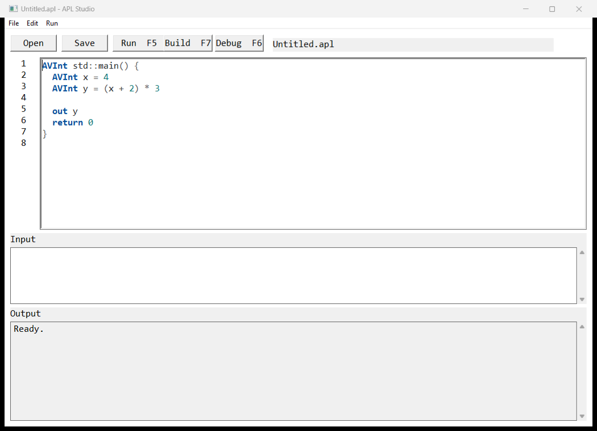

# Absolute Programming Language

Absolute Programming Language (APL) is a language we are building because
existing languages work well alone and become difficult when they have to work
together.

It is not as safe as Rust. It is not as easy as Python. It is not as close to
the machine as C.

The goal is to cover enough of all three areas that many programs no longer
need all three languages.

APL is not related to the array language created by Kenneth E. Iverson. The
name means something different here: not perfect at everything, but complete
enough that a task does not force the program into another language.

> Good enough across the whole stack. Explicit where the stack has boundaries.



APL is unfinished. The compiler is bootstrapped, but parts of the native
toolchain still use Rust. Windows programs and native executables work today.
Linux system support does not. Some diagnostics are still rough. The language
will change.

We keep building it because the entire stack is ours. The parser, checker,
linker, runtime, libraries, native ABI, and development tools can change
together. Their contracts do not have to remain hidden inside wrappers written
for someone else's language.

## A Native Window, For Example

This program creates a real Win32 window:

```apl
include >> windows

AVInt std::main() {
  WindowConfig config = WindowConfig()
  config.title = "Made with APL"
  config.width = 960
  config.height = 640
  config.minimum_width = 480
  config.minimum_height = 320

  VTime window = config.create()
  windows::show_window(window)
  return std::int(windows::run_message_loop())
}
```

The equivalent raw Win32 C program needs a registered window class, a window
procedure, instance and handle management, `CreateWindowExW`, a message loop,
and cleanup. Even a small version commonly takes around 80 lines.

A C library could hide the same boilerplate. That is not the point.

In APL, the wrapper is part of the standard checked contract. The window,
message loop, timers, controls, processes, and native resources use the same
ownership and error rules as the rest of the program.

## One Program, Not A Stack Of Languages

A real program rarely uses one language.

Python handles application logic. C++ provides a native library. Rust runs a
service. A build system connects them. Each part may work correctly on its own,
while the complete program remains fragile.

A Python integer silently crossing into a C++ `long long` may be harmless for
years and then fail on one unexpected value. Every boundary adds another place
where the program can be locally correct and globally wrong.

APL tries to remove as many of these boundaries as possible.

It should be possible to parse text without writing C-style buffer code and
then call Win32 without moving the application into C++. A program should use
high-level lists where they are convenient and explicit memory where direct
control is required. The same source should run through the portable runtime
and compile into a native executable.

This does not make every operation equally high-level.

Calling an operating-system API still requires an explicit contract. Manual
memory still requires ownership rules. Foreign functions still have an ABI.
APL does not hide these boundaries. It tries to keep them inside one checked
program instead of spreading them across several languages.

APL aims to be:

- simple enough for small scripts;
- structured enough for large applications;
- fast enough for native programs;
- low-level enough for systems work;
- strict enough to check the contracts between these layers.

It does not need to win every benchmark. It needs to stop one weak boundary
from breaking the whole program.

## What Works Today

APL currently has:

- an APL-written lexer, parser, semantic checker, IR, linker, verifier, VM,
  artifact layer, and bootstrap driver;
- portable execution and native Windows executable builds from the same
  checked source;
- explicit AV, ASV, and SASV protection levels;
- functions, lists, slicing, bounded loops, non-fallthrough `match`, classes,
  inheritance, copied C-like structures, and explicit whole-program errors;
- named `.aplmod` libraries with metadata, dependencies, namespaces,
  `include`, `exclude`, `using namespace`, and conflict-checked `nc`;
- tracked raw memory with stable identities, bounds and permission checks,
  owned and borrowed addresses, indirect calls, and explicit reclamation;
- a Windows library with DLL calls, windows, controls, RichEdit operations,
  dialogs, menus, resources, processes, timers, callbacks, and decoded events;
- a Win32 Studio with syntax highlighting, line numbers, F5 portable run, F7
  native build, and a source debugger.

The standard library currently includes math, console, bit operations,
datetime, random, timers, cryptography, classes, raw memory, and Windows.

See [the implementation status](docs/status.md) for the exact boundary. That
document is intentionally more precise and less friendly than this README.

## What Does Not Work Yet

- Native builds still use Cargo and the Rust runtime bridge for the final link.
- The native backend still represents many values through a dynamic ABI. It is
  not yet the final direct machine-code backend.
- Linux does not have its system library or native acceptance path yet.
- There is no network package registry, version solver, or lockfile.
- Synchronous callbacks from arbitrary native code into APL functions are not
  implemented.
- Some host and portable diagnostics disagree about source positions.
- The installer is not code-signed.
- APL Studio is still written in Rust. Rewriting it in APL is a future
  acceptance test for the Windows, filesystem, path, and system libraries.

These are project limits, not hidden footnotes. Current regressions are kept as
small programs under `tests/regressions/open/`.

## Trying It

The complete user experience currently targets 64-bit Windows. You need a
current Rust toolchain while the final native linker still uses Cargo.

Build a complete portable package with the CLI, Studio, compiler sources,
standard libraries, examples, and documentation:

```powershell
powershell -ExecutionPolicy Bypass -File .\tools\build_release.ps1
.\dist\package\apl_studio.exe
```

For a smaller compiler-only start:

```powershell
cargo build -p apl
.\target\debug\apl.exe check .\examples\std_main.apl
.\target\debug\apl.exe run .\examples\std_main.apl
```

Build a native executable from the command line:

```powershell
.\dist\package\apl.exe compile-native .\examples\windows_window.apl
```

Studio uses `F5` for portable execution, `F6` for debugging, and `F7` to save a
native Windows executable. Native executables do not need Studio or `.aplmod`
files at runtime.

The installer and portable archive process is described in
[the installation guide](docs/installation.md).

## How The Compiler Fits Together

The current path is deliberately mixed while APL bootstraps itself:

```text
APL source
    -> APL-written frontend and semantic checker
    -> linked APL artifact
    -> portable VM or native lowering
    -> executable
```

Rust still provides the host process, several audited system boundaries, and
the final native link. New compiler logic belongs in `std/*.apl` when the
language can express it. Operating-system primitives stay behind small host
contracts until APL can own those layers itself.

This is already more self-hosted than a source-to-C frontend, but it is not yet
an independent native toolchain. The remaining bridge is documented instead of
being renamed away.

## Repository Map

- `std/` contains the APL-written compiler and VM.
- `libraries/` contains canonical standard-library sources.
- `crates/` contains the Rust host, runtimes, system boundaries, CLI, and the
  current Studio.
- `examples/` contains small programs meant to be read and run.
- `tests/` contains language, bootstrap, regression, and manual UI tests.
- `docs/` separates implemented behavior from future design.
- `tools/` and `installer/` build the portable package and Windows installer.

Generated data lives under `build/`, `target/`, and `dist/`. It is not source.

## Documentation

- [Language reference](docs/language.md)
- [Current implementation status](docs/status.md)
- [Compiler architecture](docs/architecture.md)
- [APL Studio](docs/studio.md)
- [Windows library contract](docs/windows.md)
- [Tracked raw memory](docs/raw-memory.md)
- [Installation and distribution](docs/installation.md)
- [Roadmap and accepted future design](docs/roadmap.md)

`APL_CONTEXT.md` is the short development handoff. Historical journals remain
under `docs/history/`; they are not the current specification.

## License

APL is available under the [MIT License](LICENSE).
